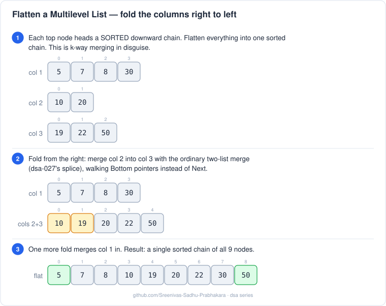

# Flatten a Sorted Multilevel Linked List

> Striver SDE Sheet 036 · Day 6 Linked List — fold the columns right-to-left, each fold a two-list sorted merge on the Bottom pointers. Go, stdlib only, tested.

## Problem

Each node of a horizontal list heads a vertical, individually sorted chain (`Bottom` pointers). Flatten everything into one fully sorted list linked purely through `Bottom`, reusing the nodes.

## Approach

This is k-way merging in disguise, done with the two-way merge you already have: recursively flatten everything to the right into one sorted chain, then merge the current column into it — the same splice-behind-a-dummy merge as merging two sorted lists, just walking `Bottom` instead of `Next`. Folding right-to-left keeps the code three lines; the cost is that the recursion depth equals the column count, and the repeated merging gives O(total · columns) worst case — a heap of column heads would get O(total · log columns) if that ever mattered.

**Complexity:** O(N·c) time worst case (N nodes, c columns), O(c) recursion stack.

## Visual walkthrough

Read the picture top to bottom — each numbered frame is one moment of the algorithm
running on this repo's test example.

## Run

    go test ./...   # verify
    go run .        # demo

---

One of 191 repos solving Striver's SDE Sheet in Go — stdlib only, one problem per repo, every solution tested. Browse the set: [`dsa-*` repos](https://github.com/Sreenivas-Sadhu-Prabhakara?tab=repositories&q=dsa-&type=source).
